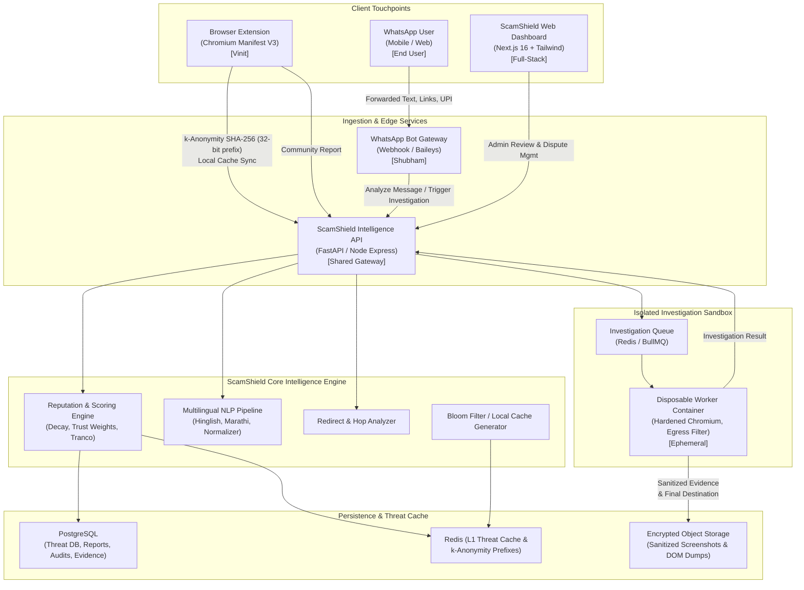
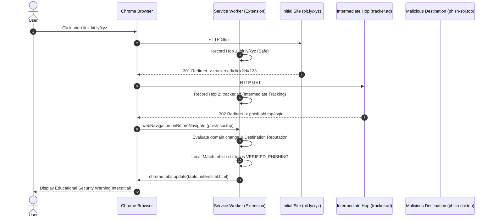
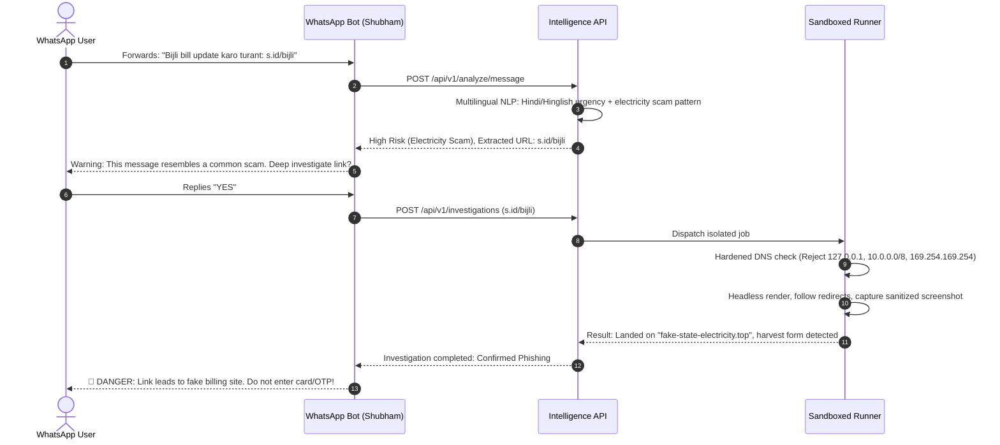

# System Architecture & Topology — ScamShield

This document details the high-level architecture of the ScamShield ecosystem, defining how components interact, communication protocols, trust boundaries, and shared services across the Browser Extension and WhatsApp Bot workstreams.

---

## 1. High-Level Architectural Diagram



---

## 2. Component Ownership & Directory Boundaries

To guarantee seamless parallel development between Vinit Surve and Shubham, the repository is partitioned into strictly isolated workspaces with explicit interface contracts:

```
scamshield/
├── dashboard/               # Next.js 16 + Tailwind dashboard (Admin & Community review)
├── extension/               # Chrome MV3 Extension (Vinit - Primary Focus)
│   ├── src/
│   │   ├── background/      # Service Worker (Navigation, DNR, Cache, Messaging)
│   │   ├── content/         # Scoped Content Scripts (DOM heuristic checks, Gmail web)
│   │   ├── popup/           # React popup UI (Status, Report URL, Preferences)
│   │   ├── interstitial/    # Safe Warning Screen for blocked navigation
│   │   ├── shared/          # Typed schemas, cryptographic hashing, utils
│   │   └── manifest.json    # Manifest V3 configuration
│   ├── package.json
│   └── tsconfig.json
├── whatsapp-bot/            # WhatsApp Verification Bot (Shubham - Primary Focus)
│   ├── src/
│   │   ├── webhook/         # WhatsApp Cloud API / Webhook handlers
│   │   ├── classification/  # Text extraction, NLP intent parsing
│   │   ├── handlers/        # Conversational state machine & user guidance
│   │   └── client/          # API client calling ScamShield Shared Intelligence
│   ├── package.json
│   └── tsconfig.json
├── backend/                 # Shared Intelligence Engine & API Gateway
│   ├── src/
│   │   ├── api/v1/          # Versioned REST endpoints (OpenAPI / Swagger)
│   │   ├── engine/          # Reputation scoring, decay, Tranco check
│   │   ├── multilingual/    # Indian languages transliteration & regex rules
│   │   └── sandbox/         # Job queue dispatcher for isolated runner
│   └── tests/
├── worker/                  # Ephemeral URL Investigation Worker (Docker / Podman)
│   ├── Dockerfile           # Minimal distroless container, no persistent secrets
│   └── runner/              # Headless browser runner with DNS-pinning & egress firewall
└── docs/                    # Complete architectural, security, and integration docs
```

---

## 3. End-to-End Data Flow

### Flow 1: Real-Time Browser Navigation Gating
1. **User clicks or navigates to a URL** in Google Chrome.
2. **Local Tier 1 Check (0ms):**
   - The Extension Service Worker queries its local in-memory Bloom filter / IndexedDB cache of known high-confidence malicious domains.
   - If hit: Navigation is immediately halted and redirected to `chrome-extension://<id>/interstitial.html?blocked_url=...` with cached threat evidence.
3. **Remote Tier 2 Check (k-Anonymity Prefix Lookup):**
   - If not in local cache and domain is not in the Tranco Top 100K list, the extension computes:
     `Hash = SHA-256(canonical_domain)`
     `Prefix = Hash.substring(0, 8)` (32 bits)
   - Extension sends `GET /api/v1/reputation/prefix/{Prefix}`.
   - The backend returns an array of known threat hashes matching that 32-bit prefix (typically 2–10 entries).
   - The extension checks locally if its full `Hash` is in the returned list.
   - **Crucial Privacy Guarantee:** The backend *never receives the domain name or URL* being visited.
4. **Verdict Render:**
   - If match found with high risk: Navigate to local warning interstitial.
   - If unknown or clean: User proceeds transparently without perceptible latency.

### Flow 2: Deceptive Redirect Chain Interception


### Flow 3: WhatsApp Scam Verification & Sandbox Investigation


---

## 4. Trust Boundaries & Network Segregation

1. **Client Untrusted Boundary:** Browser extension content scripts run in the context of arbitrary, potentially hostile web pages. Content scripts must never hold API secret keys, must never have access to sensitive extension storage, and must communicate with the Background Service Worker exclusively via strictly validated message passing.
2. **Investigation Sandbox Boundary:** The URL investigation worker processes untrusted, malicious links. It must be network-isolated from any private database, VPC internal interfaces, cloud metadata endpoints (`169.254.169.254`), and must execute with non-root credentials inside an ephemeral container that is destroyed immediately post-execution.
3. **Backend Service Boundary:** All public endpoints enforce token bucket rate limiting, strict JSON schema validation, and TLS 1.3 encryption.
