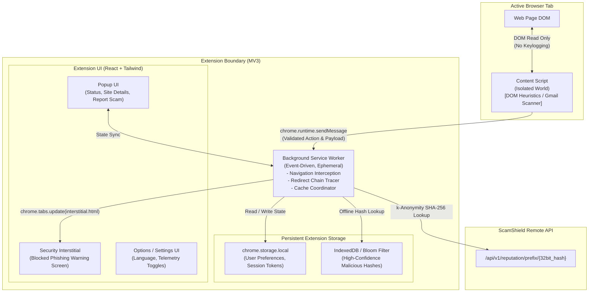

# Browser Extension Architecture (Manifest V3)

> **Lead Architect & Developer:** Vinit Surve  
> **Target Environment:** Google Chrome & Chromium Browsers (Manifest V3)

---

## 1. Architectural Principles under Manifest V3

Google Chrome Manifest V3 introduces fundamental architectural shifts compared to legacy Manifest V2:
1. **Ephemeral Background Service Workers:** Background scripts no longer run persistently in memory. They spin up in response to events (e.g., `webNavigation`, alarms, runtime messages) and terminate after idle periods (~30 seconds). All state must persist in `chrome.storage.local` or IndexedDB.
2. **Deprecation of Blocking Web Requests:** `webRequestBlocking` is unavailable for standard extensions. Dynamic, mid-flight synchronous blocking must be replaced with a hybrid strategy combining `declarativeNetRequest` (DNR) for pre-compiled high-confidence rules and `chrome.webNavigation.onBeforeNavigate` / `chrome.tabs.update` for dynamic lookups.
3. **Strict Content Security Policy (CSP):** Remote code execution (e.g., `eval()`, CDN-loaded scripts) is strictly forbidden. All code and dependencies must be bundled locally.

---

## 2. Extension Component Diagram



---

## 3. Subsystem Breakdown

### 3.1 Background Service Worker (`src/background/`)
- **Lifecycle Management:** Automatically re-hydrates state from `chrome.storage.local` upon activation. Uses `chrome.alarms` to schedule periodic delta updates for local threat bloom filters.
- **Navigation Interception Engine:**
  - Subscribes to `chrome.webNavigation.onBeforeNavigate` and `chrome.webNavigation.onCommitted`.
  - Filters out internal browser schemes (`chrome://`, `about:`, `file://`, `chrome-extension://`).
  - Canonicalizes destination URLs (stripping query parameters and fragments before hashing).
- **Redirect Chain Tracer:**
  - Maintains an in-memory session map of active navigation chains keyed by `tabId`.
  - Records transitions: `initial_url -> hop_1 -> hop_2 -> final_destination`.
  - Flags cross-origin bouncing when intermediate redirect domains belong to known affiliate trackers or high-risk URL shorteners.
- **Cache Coordinator:**
  - L1: Fast memory Set in active worker (persists during active worker lifecycle).
  - L2: `IndexedDB` storing 32-bit threat hash prefixes and Bloom filter bits.

### 3.2 Content Scripts (`src/content/`)
- **Execution Context:** Executes in Chrome's **Isolated World**. Shares the DOM with the host page but has separate execution contexts, preventing host page scripts from tampering with extension variables.
- **Passive DOM Heuristics (`content/heuristics.ts`):**
  - Scans for credential-harvesting indicators on unverified domains:
    - Presence of `<input type="password">` or credit card pattern fields on domains less than 7 days old or non-financial domains.
    - Presence of misleading branding (e.g., logo images containing "SBI", "HDFC", "Income Tax" hosted on third-party domains).
  - **Zero Keystroke Harvesting Guarantee:** The script never attaches listeners to `keypress`, `keydown`, or `input` value properties. It inspects form *metadata* only, never user *input data*.
- **Gmail Web Protection Module (`content/gmail.ts`):**
  - Injected strictly into `https://mail.google.com/*`.
  - Analyzes email header display elements:
    - Mismatch between Display Name (e.g., "State Bank of India") and actual sender email (`support@sbi-online-security.xyz`).
    - Reply-To header divergence.
    - Injects a subtle, non-intrusive security safety pill next to the sender card: **Verified Safe**, **Suspicious Domain**, or **High-Risk Phishing**.

### 3.3 Educational Security Interstitial (`src/interstitial/`)
When a navigation target is deemed high-risk or verified malicious, the Service Worker immediately redirects the tab to an internal, non-web-accessible interstitial:
`chrome-extension://<EXTENSION_ID>/interstitial.html?url=<ENCODED_TARGET>&reason=<THREAT_CODE>`

**Design Principles:**
1. **Safe by Default:** The primary action button is a large blue button: **"Back to Safety"** (triggers `chrome.tabs.goBack` or redirects to `about:newtab`).
2. **Transparent Evidence:** Explains clearly why the site was flagged:
   - *"This domain impersonates Bank of Baroda."*
   - *"This website was reported by 14 community members in the past 2 hours."*
   - *"This URL was involved in a deceptive redirect chain."*
3. **Deliberate Override:** An "Advanced / Proceed Anyway" option is hidden behind a disclosure accordion requiring explicit, deliberate user confirmation.

### 3.4 Extension Popup UI (`src/popup/`)
- Developed in **React 19** + **Tailwind CSS**, optimized for instant render under 100ms.
- **Views:**
  - **Site Security Card:** Shows current tab domain, TLS status, reputation score, and safety badge.
  - **Quick Report Dialog:** Enables one-click community reporting of phishing, fake KYC, or scam numbers/UPI IDs found on the page.
  - **Protection Controls:** Toggle proactive link scanning, redirect protection, and webmail alerts.

---

## 4. Message Passing Security

Communication between the Content Script / Popup and the Background Service Worker uses `chrome.runtime.sendMessage`. To prevent unauthorized message injection from external web pages:

```typescript
// Strict internal message schema validation
export interface ExtensionMessage<T = unknown> {
  type: 'EVALUATE_PAGE_HEURISTICS' | 'SUBMIT_COMMUNITY_REPORT' | 'GET_TAB_REPUTATION';
  payload: T;
  timestamp: number;
}

// In Background Service Worker:
chrome.runtime.onMessage.addListener((message, sender, sendResponse) => {
  // 1. Verify message origin is strictly from this extension
  if (sender.id !== chrome.runtime.id) {
    console.error('Unauthorized message origin rejected:', sender.id);
    return false;
  }
  
  // 2. Validate sender is either extension popup or registered content script tab
  if (!sender.tab && !sender.url?.startsWith(`chrome-extension://${chrome.runtime.id}`)) {
    console.error('Untrusted sender context rejected');
    return false;
  }

  // 3. Process typed actions safely
  switch (message.type) {
    case 'EVALUATE_PAGE_HEURISTICS':
      handlePageHeuristics(message.payload, sender.tab?.id);
      break;
    // ...
  }
});
```

---

## 5. Technical Limitations & Engineering Tradeoffs

| Capability | Technical Reality in Manifest V3 | ScamShield Mitigation |
| :--- | :--- | :--- |
| **Pre-Request Synchronous API Blocking** | Cannot halt HTTP request synchronously to await asynchronous backend network response without blocking API. | 1. Use DNR rules & local Bloom filter for instant offline blocking.<br>2. For unverified domains, initiate lookup in `onBeforeNavigate` and immediately redirect to interstitial if flagged before render. |
| **Service Worker Inactivity Termination** | Worker is killed after 30 seconds of inactivity; global variables are destroyed. | All state persisted to `chrome.storage.local` and IndexedDB; state re-hydrated on activation. |
| **Dynamic Script Injection** | `script-src 'unsafe-eval'` is blocked by MV3 CSP. | All parser logic, regex, and UI templates are compiled into static build bundles at compile-time. |
