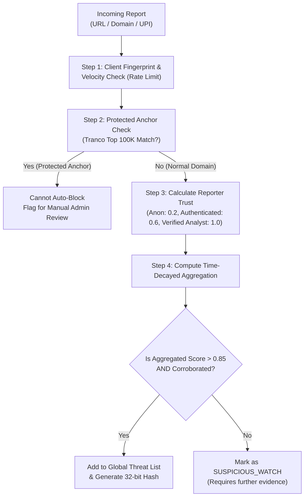

# Community Threat Intelligence & Reputation Architecture

> **Objective:** Harness crowdsourced reports from browser extension and WhatsApp users while maintaining mathematical resilience against Sybil attacks, malicious brigading, and false-positive abuse.

---

## 1. Multi-Signal Reputation Scoring Model

A community report is an indicator of suspicion, not an automated verdict. An indicator's composite risk score $R \in [0.0, 1.0]$ is computed using a weighted multi-factor formula:

$$R = w_a \cdot S_{\text{automated}} + w_c \cdot S_{\text{community}} + w_h \cdot S_{\text{heuristics}} - w_t \cdot A_{\text{anchor}}$$

Where:
- $S_{\text{automated}}$: Score from passive/sandbox automated analysis (e.g., domain age, credential forms, TLS issuer).
- $S_{\text{community}}$: Aggregated, time-decayed community report score.
- $S_{\text{heuristics}}$: Client-side DOM/redirect heuristic score.
- $A_{\text{anchor}}$: Immutable Trust Anchor bonus (from Tranco Top 100K list).
- $w_a, w_c, w_h, w_t$: Calibrated weights ($w_a = 0.40, w_c = 0.35, w_h = 0.25$).

---

## 2. Community Score with Exponential Time Decay

Reports lose potency over time as domains change ownership or clean up compromises. The community score for indicator $i$ at time $t$ is:

$$S_{\text{community}}(t) = 1 - \exp\left(-\sum_{k=1}^{N} T_k \cdot e^{-\lambda (t - t_k)}\right)$$

Where:
- $T_k \in [0.1, 1.0]$: Trust weight of reporter $k$.
- $t_k$: Timestamp of report submission.
- $\lambda$: Decay constant corresponding to a 7-day half-life ($\lambda = \frac{\ln(2)}{7 \text{ days}}$).
- $N$: Number of unique reports from distinct client fingerprints.

---

## 3. Abuse Prevention & Defense Mechanisms

### 3.1 Protected Anchors (Tranco Top 100K Immunity)
To defeat coordinated malicious brigading targeting legitimate businesses (e.g., competing startups, government portals, or major banking sites):
- Domains listed in the **Tranco Top 100,000 global list** are tagged as `IMMUNE_TO_AUTOBLOCK`.
- Even if an attacker coordinates 10,000 automated reports against `sbi.co.in`, the domain *cannot* be automatically blocked. The reports are rerouted to a high-priority manual triage queue.

### 3.2 Reporter Trust Weighting & Sybil Defenses
- **Anonymous Reports:** Trust weight $T = 0.20$.
- **Authenticated Google/OAuth Accounts:** Trust weight $T = 0.60$.
- **Verified Security Researchers / Admins:** Trust weight $T = 1.00$.
- **Penalization for False Reports:** If a user submits reports that are consistently refuted by sandbox investigations, their trust weight decays toward zero ($T \to 0.05$).

### 3.3 Dispute & False-Positive Resolution Workflow
1. Domain owners can submit an appeal via the public ScamShield web dashboard: `/dispute?domain=example.com`.
2. Appeals require DNS TXT record ownership verification (`scamshield-verify=<DISPUTE_TOKEN>`).
3. Once verified, the domain is quarantined for immediate re-investigation in the isolated sandbox.
