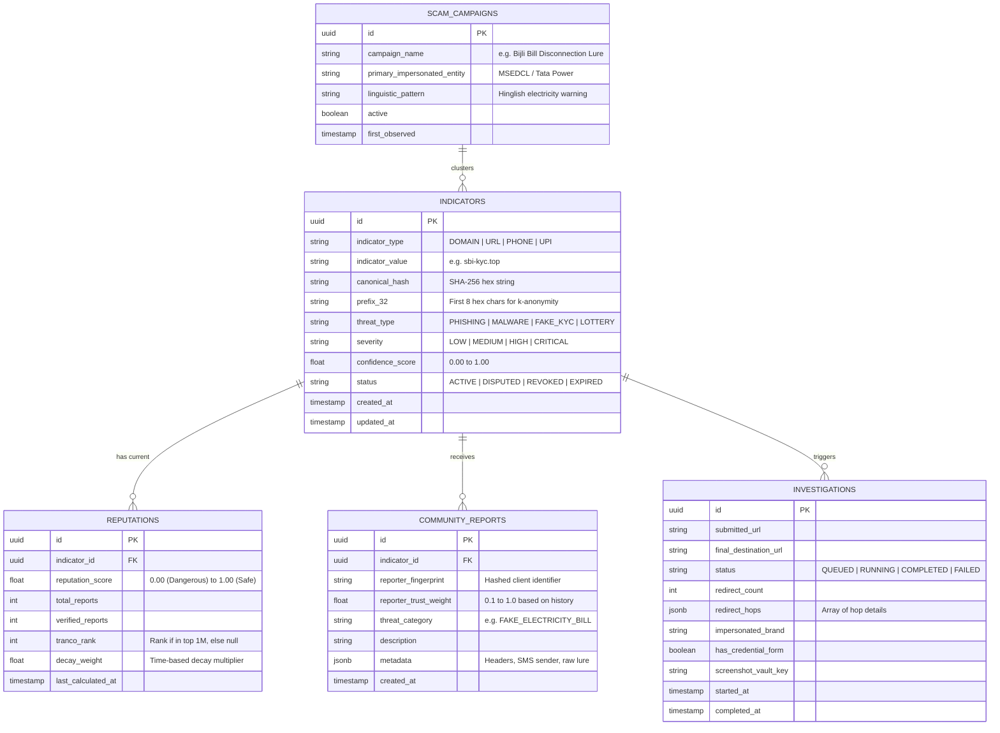

# Unified Data Model & Database Schemas

> **Target Database:** PostgreSQL 16+ (Primary Relational Persistence) & Redis 7+ (L1 Cache & k-Anonymity Index)

---

## 1. Entity-Relationship Diagram



---

## 2. PostgreSQL DDL Schemas

```sql
-- Create Enum Types
CREATE TYPE indicator_kind AS ENUM ('DOMAIN', 'URL', 'PHONE', 'UPI');
CREATE TYPE threat_severity AS ENUM ('LOW', 'MEDIUM', 'HIGH', 'CRITICAL');
CREATE TYPE threat_status AS ENUM ('ACTIVE', 'DISPUTED', 'REVOKED', 'EXPIRED');

-- Indicators Core Table
CREATE TABLE indicators (
    id UUID PRIMARY KEY DEFAULT gen_random_uuid(),
    indicator_type indicator_kind NOT NULL,
    indicator_value TEXT NOT NULL,
    canonical_hash VARCHAR(64) NOT NULL,
    prefix_32 VARCHAR(8) NOT NULL,
    threat_type VARCHAR(64) NOT NULL,
    severity threat_severity NOT NULL DEFAULT 'MEDIUM',
    confidence_score NUMERIC(3,2) NOT NULL DEFAULT 0.50,
    status threat_status NOT NULL DEFAULT 'ACTIVE',
    created_at TIMESTAMPTZ NOT NULL DEFAULT NOW(),
    updated_at TIMESTAMPTZ NOT NULL DEFAULT NOW()
);

-- Fast Indexes for k-Anonymity lookups and domain matches
CREATE INDEX idx_indicators_prefix32 ON indicators(prefix_32);
CREATE INDEX idx_indicators_hash ON indicators(canonical_hash);
CREATE UNIQUE INDEX idx_indicators_type_val ON indicators(indicator_type, indicator_value);

-- Community Reports Table
CREATE TABLE community_reports (
    id UUID PRIMARY KEY DEFAULT gen_random_uuid(),
    indicator_id UUID NOT NULL REFERENCES indicators(id) ON DELETE CASCADE,
    reporter_fingerprint VARCHAR(64) NOT NULL,
    reporter_trust_weight NUMERIC(3,2) NOT NULL DEFAULT 0.50,
    threat_category VARCHAR(64) NOT NULL,
    description TEXT,
    evidence_metadata JSONB,
    created_at TIMESTAMPTZ NOT NULL DEFAULT NOW()
);

CREATE INDEX idx_reports_indicator ON community_reports(indicator_id);
CREATE INDEX idx_reports_reporter ON community_reports(reporter_fingerprint);

-- Sandboxed URL Investigations Table
CREATE TABLE investigations (
    id UUID PRIMARY KEY DEFAULT gen_random_uuid(),
    submitted_url TEXT NOT NULL,
    final_destination_url TEXT,
    status VARCHAR(32) NOT NULL DEFAULT 'QUEUED',
    redirect_count INT DEFAULT 0,
    redirect_hops JSONB DEFAULT '[]'::jsonb,
    impersonated_brand VARCHAR(128),
    has_credential_form BOOLEAN DEFAULT FALSE,
    screenshot_vault_key TEXT,
    started_at TIMESTAMPTZ,
    completed_at TIMESTAMPTZ,
    created_at TIMESTAMPTZ NOT NULL DEFAULT NOW()
);

CREATE INDEX idx_investigations_status ON investigations(status);
```

---

## 3. Redis In-Memory L1 Cache Topology

To support sub-millisecond prefix lookups by the Extension:
- **Key:** `prefix:{prefix_32}` (e.g., `prefix:3a7f82b1`)
- **Data Type:** Redis Hash or Set
- **Payload:** Serialized JSON array of active threat records matching that 32-bit prefix.
- **TTL:** 10 minutes (refreshed asynchronously via write-through cache).
