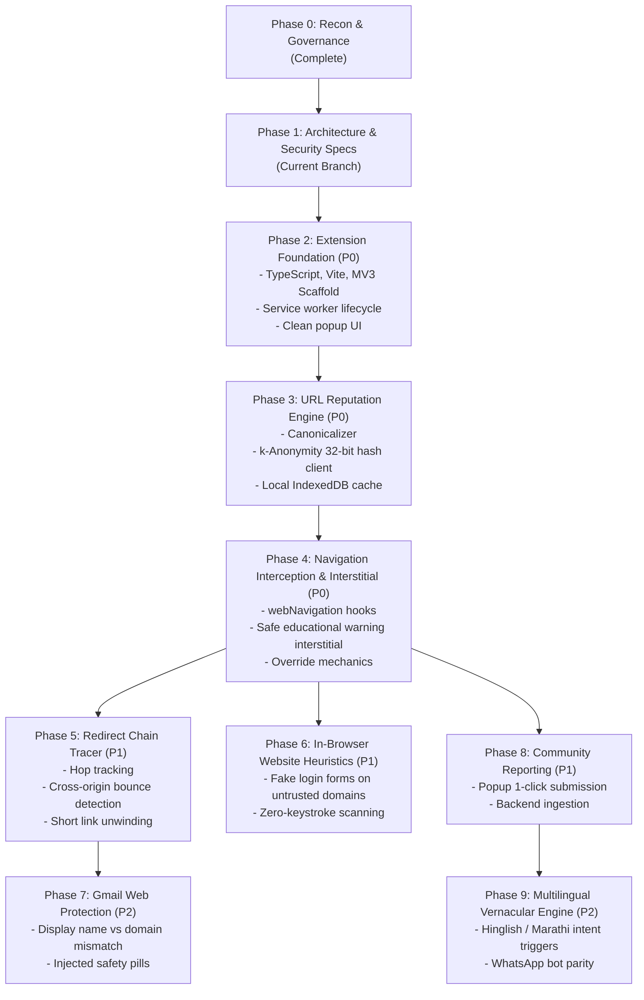

# ScamShield Engineering Roadmap & Milestones

> **Priority Taxonomy:**
> - **P0 (Critical / Hackathon Core):** Mandatory for MVP security and end-to-end functionality.
> - **P1 (Important):** Key differentiators (redirect tracing, community reporting, local caching).
> - **P2 (Enhancement):** Advanced heuristics (Gmail scanner, multilingual Indian NLP).
> - **P3 (Future / Post-Hackathon):** Enterprise sandbox scaling, cross-browser support.

---

## 1. Roadmap Overview & Dependencies

---

## 2. Detailed Phase Specifications

### Phase 0: Reconnaissance & Governance (Completed)
- **Scope:** Repository structure audit, branch governance, ownership division (Vinit vs. Shubham).
- **Deliverables:** Clean repository state, branch rules, and initial README.

### Phase 1: Architecture & Security Design (Current)
- **Scope:** Comprehensive engineering blueprints, threat model, API schemas, and ADRs.
- **Deliverables:** All documentation inside `docs/` and `docs/DECISIONS/`.
- **Target Branch:** `vinit-scamshield-architecture`.

### Phase 2: Browser Extension Foundation (P0)
- **Scope:**
  - Build pipeline using Vite + React 19 + TypeScript.
  - Manifest V3 manifest declaration with minimal permissions (`storage`, `webNavigation`, `alarms`).
  - Service worker initialization and message bus.
  - Modern, responsive Popup UI shell using Tailwind CSS.
- **Acceptance Criteria:**
  - Extension loads cleanly in `chrome://extensions` in Developer Mode without warnings.
  - Service worker recovers state cleanly after worker termination.
- **Estimated Complexity:** Medium | **Owner:** Vinit

### Phase 3: URL Reputation & Privacy Engine (P0)
- **Scope:**
  - Client-side URL canonicalizer (stripping auth tokens/query params).
  - SHA-256 hasher and 32-bit prefix generator.
  - Local IndexedDB / memory cache for offline known-threat verification.
  - Asynchronous k-Anonymity API client calling `/api/v1/reputation/prefix/{prefix}`.
- **Acceptance Criteria:**
  - Lookup latency < 2ms for local cache hits.
  - Network request transmits only 8 hex characters (32 bits), zero full URLs transmitted.
- **Estimated Complexity:** Medium | **Owner:** Vinit

### Phase 4: Basic Browser Protection & Interstitial (P0)
- **Scope:**
  - Intercepting navigation via `chrome.webNavigation.onBeforeNavigate`.
  - Redirecting flagged tabs to `chrome-extension://<id>/interstitial.html`.
  - Educational warning interstitial showing threat category, evidence, and "Back to Safety" default.
  - "Proceed Anyway" deliberate override with warning acknowledgment.
- **Acceptance Criteria:**
  - Visiting a test phishing URL reliably renders the warning screen.
  - Clicking "Back to Safety" redirects safely without exposing the page.
- **Estimated Complexity:** High | **Owner:** Vinit

### Phase 5: Redirect Protection Engine (P1)
- **Scope:**
  - Session-level tracking of active navigation chains per tab.
  - Tracking transition: `shortener -> ad_tracker -> malicious_landing`.
  - Halting navigation if an intermediate hop or final destination is malicious.
- **Acceptance Criteria:**
  - Detects and interrupts multi-hop redirects leading to blacklisted domains.
- **Estimated Complexity:** High | **Owner:** Vinit

### Phase 6: In-Browser Website Heuristics (P1)
- **Scope:**
  - Content script scanning DOM on unverified new domains.
  - Detecting password inputs / payment cards on newly registered domains.
  - Detecting bank logos hosted on unofficial domains.
  - Strict privacy rule: Zero keystroke listeners or form value capture.
- **Acceptance Criteria:**
  - Alerts user via extension badge when a suspicious login form is found on an unrated domain.
- **Estimated Complexity:** Medium | **Owner:** Vinit

### Phase 7: Gmail Web Protection (P2)
- **Scope:**
  - Dedicated content script scoped strictly to `mail.google.com`.
  - Parsing sender display name vs. actual SMTP header address.
  - Injected safety pill next to sender envelope.
- **Acceptance Criteria:**
  - Flags "State Bank of India <spammer@evil.com>" with a high-visibility warning pill.
- **Estimated Complexity:** Medium | **Owner:** Vinit

### Phase 8: Community Reporting (P1)
- **Scope:**
  - Popup UI report tab allowing users to submit current site as phishing/scam.
  - Optional threat category selection and evidence description.
  - Dispatches `POST /api/v1/reports` with client rate limiting.
- **Acceptance Criteria:**
  - Report recorded in backend and reflected in threat intelligence scoring.
- **Estimated Complexity:** Low | **Owner:** Vinit

### Phase 9: Multilingual Scam Detection (P2)
- **Scope:**
  - Integration of Indian vernacular scam dictionaries (Hindi, Marathi, Hinglish).
  - Parity between WhatsApp bot text classifier and extension webmail scanner.
- **Estimated Complexity:** High | **Owner:** Shared (Vinit & Shubham)

### Phase 10: Advanced Sandboxed URL Investigation (P3)
- **Scope:**
  - Ephemeral container runner with hardened DNS pinning and egress firewall.
  - Automated headless screenshot and DOM capture for disputed/new domains.
- **Estimated Complexity:** High | **Owner:** Shared / Backend
