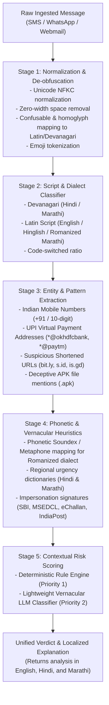

# Multilingual Scam Detection Strategy (Indian Threat Landscape)

> **Context:** India's cyber fraud ecosystem is uniquely characterized by multi-dialect code-switching, Romanized regional languages (Hinglish, Romanized Marathi), and hyper-localized social engineering scripts.

---

## 1. The Linguistic Challenge in Indian Cyber Fraud

Scammers deliberately bypass standard English keyword filters by crafting messages in:
1. **Vernacular Devanagari Script:**
   - Hindi: *"आपका बैंक खाता आज बंद हो जाएगा। तुरंत KYC अपडेट करें।"*
   - Marathi: *"तुमचे बँक खाते आज बंद होणार आहे. त्वरित KYC अपडेट करा."*
2. **Romanized Vernacular (Hinglish & Romanized Marathi):**
   - Hinglish: *"Dear customer aapka SBI Yono account block ho gaya hai. Pan card link karein turant."*
   - Romanized Marathi: *"Tumcha light bill baki aahe. Aaj ratri 9:30 la power cut honar. Contact kara 9876543210."*
3. **Mixed-Script Code-Switching:**
   - *"Dear SBI ग्राहक, your account बंद होईल if KYC not updated."*
4. **Adversarial Obfuscation & Homoglyphs:**
   - Replacing Latin characters with visually identical Cyrillic glyphs (e.g., Cyrillic 'а' `U+0430` instead of Latin 'a' `U+0061`).
   - Inserting zero-width spaces (`U+200B`) and deceptive emojis to break regex tokens.

---

## 2. Multi-Stage NLP Detection Pipeline

---

## 3. Vernacular Scam Dictionaries & Intent Signatures

### 3.1 Urgency & Threat Triggers
| Category | English | Hindi (Devanagari / Hinglish) | Marathi (Devanagari / Romanized) |
| :--- | :--- | :--- | :--- |
| **Account Closure** | Account blocked today, Immediate action | खाता बंद (khata band), आज ही (aaj hi), तुरंत (turant), ब्लॉक (block) | खाते बंद (khate band), त्वरित (tvarit), आजच (aajach), तात्काळ (tatkal) |
| **Electricity Disconnection** | Power cut tonight, Electricity bill unpaid | बिजली बिल (bijli bill), कनेक्शन कटेगा (connection katega), आज रात (aaj raat) | वीज बिल (veej bill), वीज पुरवठा खंडित (purvatha khandit), आज रात्री (aaj ratri) |
| **Fake Delivery** | Parcel detained, Address update needed | पार्सल रुका है (parcel ruka hai), पता अपडेट (pata update) | पार्सल अडकले (parcel adakle), पत्ता अपडेट (patta update) |
| **Job / Task Fraud** | Like videos earn 5000 daily | रोज़ 5000 कमाएं (roz 5000 kamaye), घर बैठे काम (ghar baithe kaam) | दररोज 5000 कमवा (darroj 5000 kamva), घरबसल्या काम (gharbaslya kaam) |

---

## 4. Why "Translation-First" Fails (Architectural Decision)

A naive architecture translates all incoming text to English via Google Translate / DeepL before running classification. **This is fundamentally flawed for Indian cyber fraud:**
1. **Loss of Colloquial Urgency:** Translating *"Aapka light bill update nahi hua to raat ko light cut jayega"* often mistranslates idioms or flattens subtle social-engineering nuances.
2. **Entity Mangling:** Machine translation models frequently mangle Indian names, bank abbreviations, or UPI handles into regular English nouns.
3. **Latency & Cost Overhead:** External translation introduces 200–500ms of API latency and increases per-request costs by 300%.

**ScamShield's Hybrid Stance:**
- Keep the original text intact.
- Apply local deterministic regex and phonetic rules directly on the original script/transliteration.
- Use multilingual LLMs (trained on Indic tokens) natively without intermediate translation.
- Generate explanations back in the user's preferred language (English, Hindi, or Marathi).
