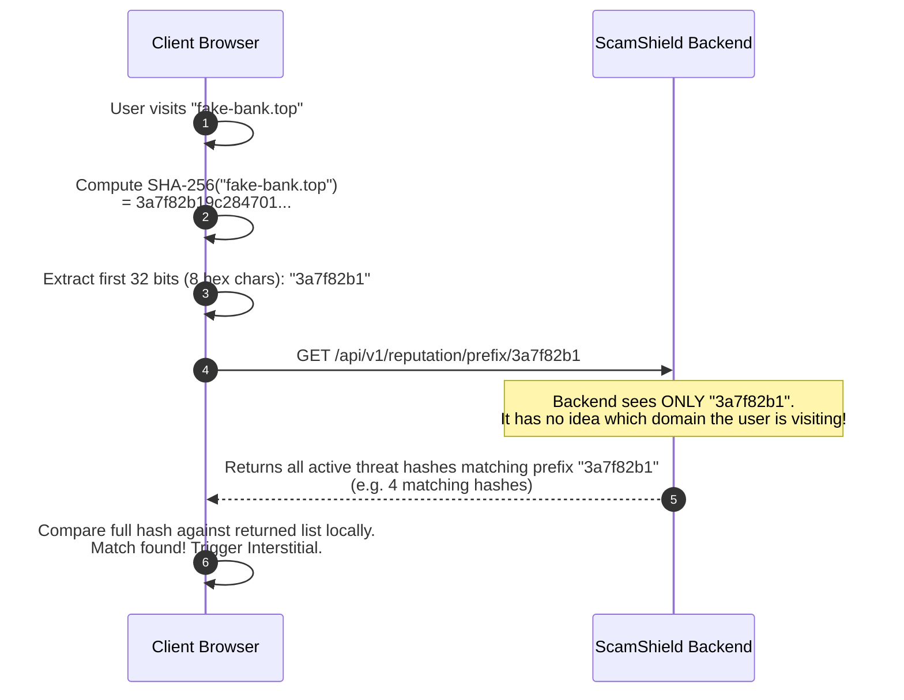

# Privacy Architecture & Telemetry Boundaries

> **Core Commitment:** User privacy is non-negotiable. ScamShield does not monetize browsing habits, does not harvest personal credentials, and strictly enforces zero-telemetry architectures.

---

## 1. Data Collection Taxonomy: What We Collect vs. What We NEVER Collect

| Data Category | Collected? | Architectural Justification & Guarantee |
| :--- | :--- | :--- |
| **Passwords & Form Inputs** | ❌ **NEVER** | The extension never reads `<input>` values. Content scripts only check element tags (`type="password"`), not user keystrokes. |
| **Full Browsing History** | ❌ **NEVER** | ScamShield does not log or persist browsing logs. Visited URLs are never sent to a telemetry analytics server. |
| **Cookies & Session Tokens** | ❌ **NEVER** | We do not request the `cookies` permission in Manifest V3. Session states remain strictly isolated inside the browser. |
| **Raw Destination URLs with Query Params** | ❌ **NEVER** | Query strings containing session IDs (`?auth=xyz`) are stripped locally in memory before hashing. |
| **32-Bit Domain Hash Prefix** | ✅ **YES** | For unrated domains not present in local cache, an 8-character hex prefix (`SHA-256(domain)[0..8]`) is queried to protect privacy. |
| **User-Submitted Threat Reports** | ✅ **YES** | When a user explicitly clicks "Report Scam", the reported URL, category, and timestamp are transmitted to the threat DB. |

---

## 2. Mathematical Privacy: k-Anonymity via Prefix Hashing

To resolve the tension between real-time threat detection and user privacy, ScamShield employs **k-Anonymity prefix hashing** (analogous to the privacy architecture used in Chromium Safe Browsing):

**Privacy Guarantee:** The ScamShield backend only learns that a user visited *some* domain whose hash begins with a common 32-bit prefix. Over $2^{32}$ potential domains map to this space, providing mathematical anonymity.

---

## 3. Compliance with Indian DPDP Act (2023)

ScamShield is engineered to comply with India's **Digital Personal Data Protection Act, 2023 (DPDP)**:
- **Purpose Limitation:** Data gathered via community reporting is used solely for cybercrime prevention and threat alerting.
- **Data Minimization:** Only indicator values (domains, hashes, UPI handles) are stored; no individual device identifiers or IP logs are permanently retained.
- **Right to Erasure & Dispute:** Legitimate domain owners can submit disputes to purge stale or incorrect threat records.
