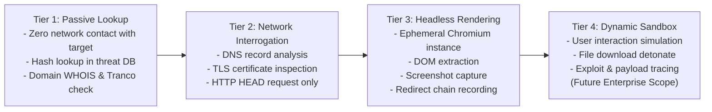
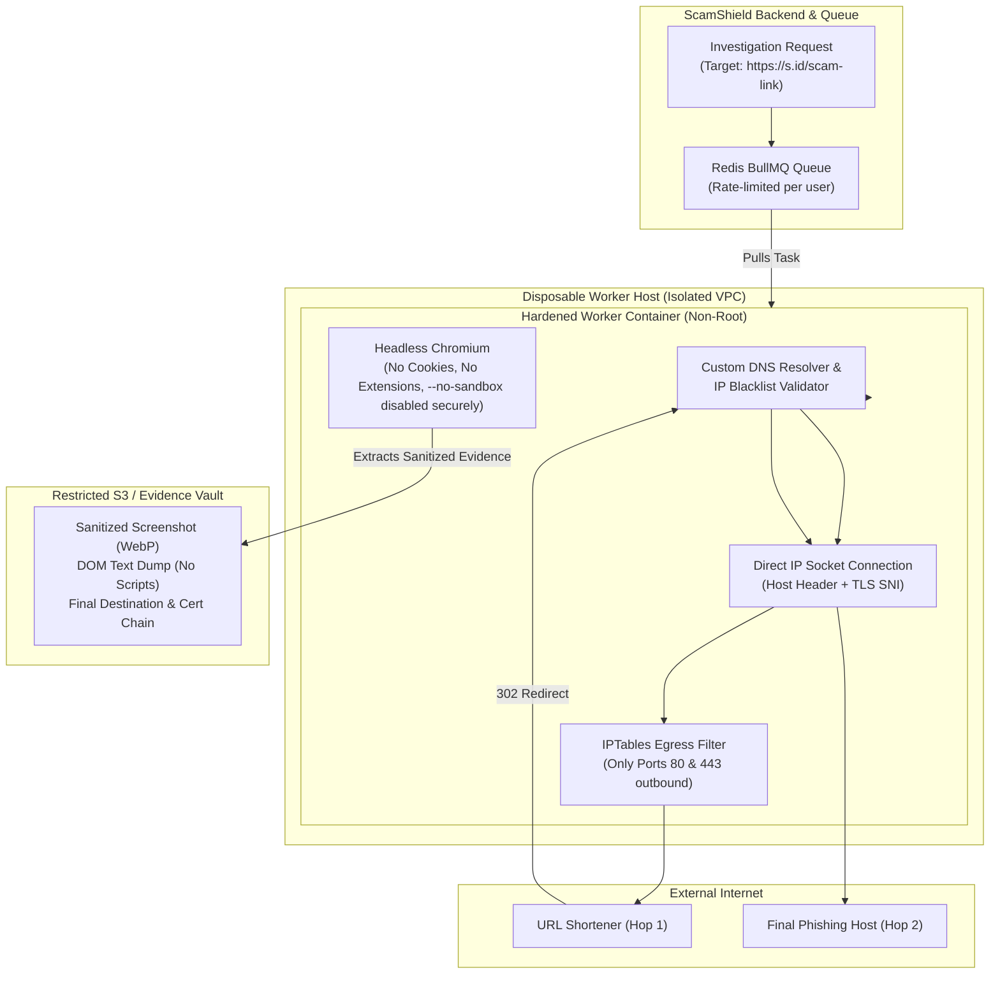

# Isolated URL Investigation & Sandbox Security Architecture

> **Critical Safety Rule:** Never execute, fetch, or render an untrusted, user-submitted URL in a developer's local browser, development machine, or within any environment possessing production secrets or access to internal networks.

---

## 1. Spectrum of URL Analysis (Clarifying Definitions)

To prevent false claims of "sandboxing", ScamShield rigorously distinguishes between four distinct tiers of analysis:

ScamShield's automated deep URL investigation functions at **Tier 3 (Isolated Headless Rendering)** with enterprise-grade SSRF and egress defenses.

---

## 2. Sandboxed Investigation Runner Topology

---

## 3. Mandatory Defense-in-Depth Controls

### 3.1 Network Egress & SSRF Protection
The worker must never be capable of reaching local networks, other containers, or cloud infrastructure APIs.
1. **Strict CIDR Disallowlist:** Any destination IP resolving to the following ranges is immediately dropped and flagged as an SSRF attack:
   - `0.0.0.0/8` (Current network)
   - `10.0.0.0/8` (RFC 1918 Private)
   - `100.64.0.0/10` (Shared Address Space / CGNAT)
   - `127.0.0.0/8` (Loopback)
   - `169.254.0.0/16` (Link-Local / AWS & GCP Metadata)
   - `172.16.0.0/12` (RFC 1918 Private)
   - `192.168.0.0/16` (RFC 1918 Private)
   - `::1/128`, `fc00::/7`, `fe80::/10` (IPv6 Private / Unique Local)
2. **DNS Rebinding Prevention (IP Pinning):**
   - The worker resolves the hostname once using a dedicated DNS client.
   - If the resolved IP passes the CIDR check, the HTTP request is dispatched directly to that specific IP address.
   - The original domain name is supplied via the `Host` header and TLS SNI extension.
   - Host resolution is disabled inside the underlying HTTP client library to prevent a secondary, unverified lookup.
3. **Hop-by-Hop Redirect Validation:**
   - Every HTTP redirect (`301`, `302`, `307`, `308`, or JavaScript `window.location`) pauses the fetch.
   - The redirect target is subjected to the exact same full DNS and SSRF validation before establishing a new socket.

### 3.2 Host & Container Hardening
- **Disposable Lifecycle:** Workers are spun up on-demand or refreshed after a maximum of 10 investigations. Containers are destroyed with `docker run --rm` to ensure zero state accumulation.
- **Zero Secrets Injected:** Worker containers run with an empty environment. No database passwords, GitHub tokens, AWS IAM roles, or WhatsApp webhook keys are mounted or accessible within the container.
- **Read-Only Root Filesystem:** Container runs with `--read-only` root filesystem and a 64MB ephemeral `/tmp` mounted in memory (`tmpfs`).
- **Resource Constraints (cgroups):**
  - **Memory:** Capped at 512MB per worker.
  - **CPU:** 0.5 vCPU maximum.
  - **Wall-Clock Timeout:** Hard abort after 15 seconds total execution time.
  - **Max Redirect Hops:** Hard limit of 5 hops; subsequent hops terminate with a `REDIRECT_LOOP_DETECTED` status.
  - **Max Response Payload:** Clamped at 5MB to thwart decompression bombs (gzip bombs) and gigabyte file streams.

---

## 4. Evidence Extraction & Sanitization

1. **Sanitized Screenshots:** Captured via Chromium DevTools Protocol (`Page.captureScreenshot`), downsampled to 1024x768 WebP, and stripped of all EXIF metadata.
2. **DOM Text Dump:** Extracted as pure text and structured element metadata (form count, input types, external script origins). Raw `<script>` tags, inline event handlers, and executable payloads are stripped prior to storage.
3. **Zero Cookie / Credential Retention:** Browser cookies and localStorage are stored in a transient in-memory profile that vanishes upon worker exit.
